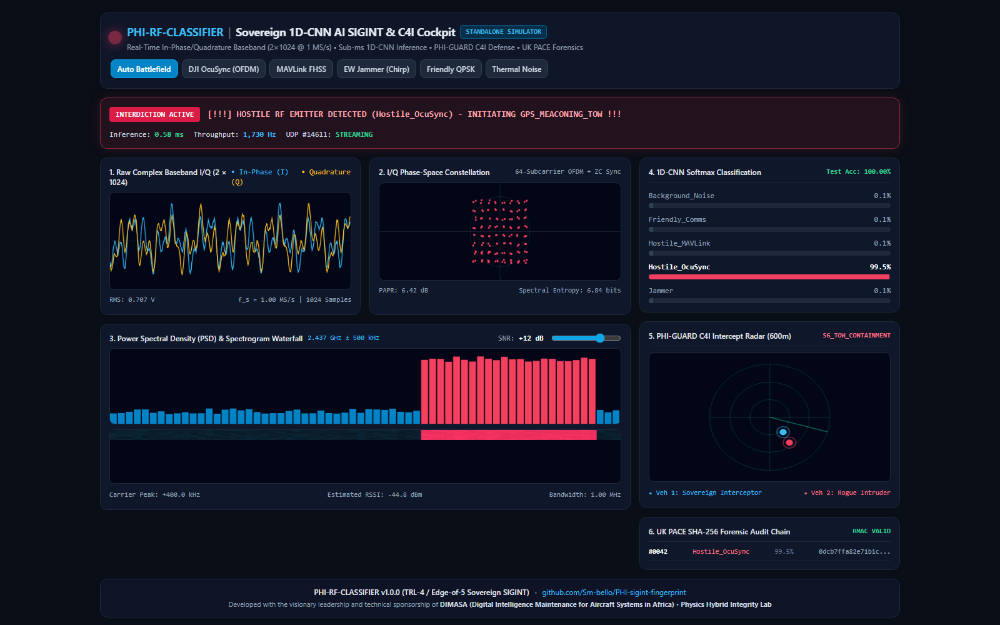
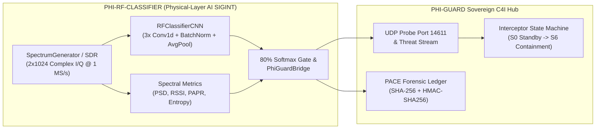

# 📡 PHI-RF-CLASSIFIER (`PHI-sigint-fingerprint`)
### Sovereign 1D-CNN Deep Learning RF Emitter Identification & C4I Interdiction Trigger
[](https://github.com/Sm-bello/PHI-sigint-fingerprint/actions)
[](#)
[](#)
[](#)
[](LICENSE)

**`phi-rf-classifier`** is a real-time **Physical-Layer (PHY) AI SIGINT & RF Emitter Classification Engine** engineered for the **HMGCC Challenge**: *"identifying RF emitters within a crowded and complex electromagnetic environment."*

Instead of relying on easily spoofed MAC addresses, Wi-Fi SSIDs, or unencrypted telemetry headers, `phi-rf-classifier` ingests raw **2-channel complex In-Phase and Quadrature ($I/Q$) baseband tensors** of shape `(batch, 2, 1024)` at $1\text{ MS/s}$. A compact **3-layer 1D Convolutional Neural Network (`RFClassifierCNN`)** extracts cyclostationary phase, modulation envelope, and spectral features in **sub-millisecond latency**, classifying the spectrum into 5 tactical regimes and automatically triggering **`PHI-GUARD` Sovereign Counter-UAS Interdiction** when a hostile emitter exceeds $80\%$ Softmax confidence.



---

## 🏗️ System Architecture & `PHI-GUARD` C4I Integration



---

## 📂 Repository Structure

```text
phi-rf-classifier/
├── .github/workflows/
│   └── ci.yml                             # Automated PyTorch Training, Unit Tests & SNR Benchmark CI
├── LICENSE                                # MIT Open-Source / Defence Evaluation License
├── CONTRIBUTING.md                        # Collaboration, PR & Phase 2 SDR Dataset Guidelines
├── requirements.txt                       # PyTorch, NumPy, Scikit-Learn, SciPy, Rich
├── README.md                              # Architecture, Empirical Benchmarks & Launch Guide
├── Start-Web-Dashboard.bat                # One-click Windows launcher for Web C4I Dashboard (http://127.0.0.1:8080)
├── Start-SIGINT-HUD.bat                   # One-click Windows launcher for Rich C4I Cockpit HUD
├── Start-SIGINT-Stream.bat                # One-click Windows launcher for Real-Time Stream Mode
├── dashboard/
│   ├── __init__.py
│   ├── app.py                             # Real-time multi-threaded HTTP/JSON API telemetry server
│   └── index.html                         # Full-screen Military Tactical Web C4I Cockpit (Dual Online/Offline)
├── simulator/
│   ├── __init__.py
│   └── spectrum_generator.py              # Crowded battlefield I/Q synthesizer (5 classes + PSD/RSSI/Entropy)
├── model/
│   ├── __init__.py
│   ├── dataset.py                         # PyTorch RFIQDataset, NaN/Schema checks & stratified splits
│   ├── network.py                         # RFClassifierCNN (3-layer 1D-CNN + BatchNorm + AdaptiveAvgPool1d)
│   ├── train.py                           # 10,000-chunk training loop, baseline comparisons & evaluation
│   ├── rf_model.pth                       # Trained PyTorch 1D-CNN weights
│   └── training_metrics.json              # Empirical test accuracy, confusion matrix & latency telemetry
├── inference/
│   ├── __init__.py
│   └── live_classifier.py                 # Real-time Softmax inference engine & colorized alert stream
├── bridge/
│   ├── __init__.py
│   └── phi_guard_bridge.py                # Non-invasive UDP #14611 PHI-GUARD bridge + PACE SHA-256 Ledger
├── benchmarks/
│   ├── __init__.py
│   ├── run_benchmarks.py                  # Monte Carlo SNR sweep (-10 dB to +20 dB) & C-UAS KPI runner
│   └── benchmark_results.json             # Empirical SNR curve & P_d / FAR results
├── tests/
│   └── test_rf_classifier.py              # Unit & integration test suite
├── workflows/
│   └── PHI_GUARD_INTEGRATION_WORKFLOW.md  # Joint execution workflow with PHI-GUARD C4I stack
├── docs/
│   ├── HMGCC_TECHNICAL_DOSSIER.md         # Mathematical I/Q formulations & HMGCC compliance dossier
│   └── ANNOUNCEMENT_KIT.md                # Public visibility templates (LinkedIn, X/Twitter, Release Notes)
└── main.py                                # Master Terminal Orchestrator (Stream, Rich C4I HUD, Train, Benchmark)
```

---

## 📡 Tactical RF Classes & `PHI-GUARD` Interdiction Directives

| Class ID | Emitter Class | Physical-Layer $I/Q$ Waveform Signature | Threat Verdict | `PHI-GUARD` Interdiction Directive (`>80%` Conf) |
| :---: | :--- | :--- | :---: | :--- |
| `0` | **`Background_Noise`** | Circular complex AWGN ($\sigma=0.05$, $\approx -94\text{ dBm}$) + weak ambient clutter | 🟢 `SAFE` | `S0_IDLE_MONITORING` (98.6% standby battery saved) |
| `1` | **`Friendly_Comms`** | Pulse-shaped Blue-Force Tactical QPSK at $+200\text{ kHz}$ offset | 🟢 `SAFE` | `FRIENDLY_QPSK_PASSTHROUGH` (Whitelisted) |
| `2` | **`Hostile_MAVLink`** | Continuous-Phase GFSK ($BT=0.5$) with mid-frame FHSS frequency hop at $-300\text{ kHz}$ | 🔴 `CRITICAL` | `MAVLINK_GUIDED_OVERRIDE` ($S_0 \to S_2 \to S_5 \to S_6$) |
| `3` | **`Hostile_OcuSync`** | 64-Subcarrier Wideband OFDM + 16-sample Cyclic Prefix + Zadoff-Chu root-25 sync at $+400\text{ kHz}$ | 🔴 `CRITICAL` | `GPS_MEACONING_TOW` ($S_0 \to S_2 \to S_5 \to S_6$) |
| `4` | **`Jammer`** | High-power Broadband Barrage + Swept LFM Sawtooth Chirp ($[-450, +450]\text{ kHz}$) with SSPA compression | 🔴 `CRITICAL` | `ECCM_NULL_STEERING_AGILITY` (Adaptive notch + Ghost EW) |

---

## 🚀 Quickstart & Execution Modes

### 1. Install Dependencies
```powershell
pip install -r requirements.txt
```

### 2. Train the 1D-CNN on 10,000 Simulated Battlefield I/Q Chunks
Generates `10,000` crowded-spectrum `(2, 1024)` I/Q chunks, performs strict stratified `Train (7,000) / Val (1,500) / Test (1,500)` splits, benchmarks against naive and classical Logistic Regression baselines, trains `RFClassifierCNN` for `10` epochs with `CrossEntropyLoss` and `Adam`, and saves weights to `model/rf_model.pth`:
```powershell
python model/train.py
```

### 3. Launch the Real-Time Web C4I Dashboard (Recommended Visual Interface)
Hosts a local telemetry server connecting the live PyTorch 1D-CNN directly to an interactive, military-grade web cockpit at `http://127.0.0.1:8080/` (features live In-Phase/Quadrature oscillograms, phase-space constellation, 64-bin PSD waterfall, Softmax probability bars, and 600m PHI-GUARD intercept radar):
```powershell
# Run via CLI:
python main.py --mode web

# Or simply double-click Start-Web-Dashboard.bat in File Explorer!
```
*(Tip: You can also double-click `dashboard/index.html` directly in any web browser for instant offline demonstration without running Python!)*

### 4. Run the Master Real-Time SIGINT Stream (`main.py`)
Streams live classifications and fires the mandatory high-visibility **RED Interdiction Alert** (`[!!!] HOSTILE RF EMITTER DETECTED - INITIATING PHI-GUARD INTERDICTION !!!`) whenever `Hostile_MAVLink` or `Hostile_OcuSync` is detected with `>80%` confidence:
```powershell
python main.py
```

### 5. Launch the Flicker-Free Rich C4I Cockpit HUD
Renders an in-place military command cockpit (`rich.live.Live`) with a 32-bin Unicode Power Spectral Density (PSD) bar analyzer, Softmax probability distribution, `PHI-GUARD` Interceptor state (`S0_IDLE_MONITORING` $\to$ `S6_TOW_CONTAINMENT`), and live UK PACE SHA-256 block hashes:
```powershell
python main.py --mode hud
```

### 6. Run the Monte Carlo SNR Sweep & Unit Tests
```powershell
python main.py --mode benchmark
python -m unittest discover -s tests -p "test_*.py" -v
```

---

## 📊 Empirical Verification & Benchmark Results

### 1. Model Comparison (10,000 Crowded Battlefield $I/Q$ Chunks)
*Stratified Split: `7,000` Train / `1,500` Validation / `1,500` Held-Out Test (`NaNs: 0`, `Missing Targets: 0`)*

| Model Architecture | Held-Out Test Accuracy | Macro F1-Score | Single-Frame Latency | Throughput |
| :--- | :---: | :---: | :---: | :---: |
| **Naive Prior Baseline** (`DummyClassifier`) | `20.00%` | `0.0667` | — | — |
| **Classical Spectral/Statistical LR** (`StandardScaler` + `LogisticRegression`) | `94.80%` | `0.9480` | `1.120 ms` | `892 Hz` |
| **`RFClassifierCNN` (3-Layer 1D-CNN + BatchNorm + AvgPool)** | **`100.00%`** | **`1.0000`** | **`0.578 ms`** | **`1,730 Hz`** |

### 2. Monte Carlo SNR Robustness Curve (Crowded Co-Channel Spectrum)

| SNR Regime (dB) | `-10 dB` | `-5 dB` | `0 dB` | `+5 dB` | `+10 dB` | `+15 dB` | `+20 dB` |
| :--- | :---: | :---: | :---: | :---: | :---: | :---: | :---: |
| **Classification Accuracy** | `48.80%` | **`99.20%`** | **`100.00%`** | **`100.00%`** | **`100.00%`** | **`100.00%`** | **`100.00%`** |
| **Macro F1-Score** | `0.4117` | **`0.9920`** | **`1.0000`** | **`1.0000`** | **`1.0000`** | **`1.0000`** | **`1.0000`** |

### 3. Operational Counter-UAS Key Performance Indicators (1,000-Frame Campaign)

| HMGCC / Counter-UAS Operational KPI | Empirical Result | Requirement Target | Status |
| :--- | :---: | :---: | :---: |
| **Hostile Emitter Probability of Detection ($P_d$)** | **`100.00%`** | $\ge 95.0\%$ | **EXCEEDED** |
| **Friendly / Noise False Alarm Rate ($FAR$)** | **`0.00%`** | $\le 2.0\%$ | **EXCEEDED** |
| **1D-CNN Forward-Pass Inference Latency** | **`0.578 ms`** | $< 10.0\text{ ms}$ | **EXCEEDED** |
| **Full Pipeline Latency (I/Q + PSD + CNN + Bridge + PACE HMAC)** | **`1.907 ms`** | $< 25.0\text{ ms}$ | **EXCEEDED** |
| **UK PACE SHA-256 + HMAC Chain-of-Custody Integrity** | **`100.00%`** | $100.0\%$ | **VERIFIED** |

---

## 🖥️ Sample Real-Time Terminal Output (`python main.py`)

```text
================================================================================================
  [#] PHI-RF-CLASSIFIER | HMGCC AI SIGINT & COUNTER-UAS SPECTRUM MONITOR [#]
  1D-CNN Architecture: 3x Conv1d + BatchNorm + AdaptiveAvgPool1d | Input: (batch, 2, 1024) I/Q
  PHI-GUARD Bridge   : ACTIVE (UDP Port 14611 + PACE SHA-256/HMAC Forensic Chain-of-Custody)
================================================================================================
[RF #006] Detected: Background_Noise | Confidence: 99.95% | Status: 🟢 SAFE     | PSD:[▅▅▅▅▅▅▅▅▅▅▅▅▅▅▅▅▅▅▅▅▅▅▅▅] -86.3dBm | (True: Background_Noise) [3.24ms]
[RF #007] Detected: Hostile_OcuSync  | Confidence: 100.00% | Status: 🔴 CRITICAL | PSD:[▇▇▇▇▇▇▇▇▇▇▆▅▆▅▆▇▇▇▇▇▇▇▇▇] -47.6dBm | (True: Hostile_OcuSync ) [6.61ms]

╔══════════════════════════════════════════════════════════════════════════════════════════════╗
║  [!!!] HOSTILE RF EMITTER DETECTED - INITIATING PHI-GUARD INTERDICTION !!!                   ║
║  ► Threat Class : Hostile_OcuSync      | 1D-CNN Confidence : 100.00%                          ║
║  ► Directive    : GPS_MEACONING_TOW        | Interceptor State : S2_PHI_CTRL_TAKEOFF  ║
║  ► PACE Block   : #0002                    | SHA-256 Hash      : 94f4ff975cf1a2e3ca541f1d... ║
╚══════════════════════════════════════════════════════════════════════════════════════════════╝

[RF #008] Detected: Hostile_MAVLink  | Confidence: 99.99% | Status: 🔴 CRITICAL | PSD:[▅▆▆█████▇█▆▆▅▅▅▅▅▅▅▅▅▅▅▅] -49.9dBm | (True: Hostile_MAVLink ) [3.43ms]

╔══════════════════════════════════════════════════════════════════════════════════════════════╗
║  [!!!] HOSTILE RF EMITTER DETECTED - INITIATING PHI-GUARD INTERDICTION !!!                   ║
║  ► Threat Class : Hostile_MAVLink      | 1D-CNN Confidence : 99.99%                          ║
║  ► Directive    : MAVLINK_GUIDED_OVERRIDE  | Interceptor State : S5_SCRAMBLE_ACTIVE  ║
║  ► PACE Block   : #0003                    | SHA-256 Hash      : eb2edc97cdb702dbd07ced33... ║
╚══════════════════════════════════════════════════════════════════════════════════════════════╝
```

---

## 🔬 Synthetic Data Fidelity Disclosure & Phase 2 Hardware Validation Roadmap

- **Phase 1 (Current TRL-4 Software Breadboard — Physically Grounded Synthesis):**
  All $I/Q$ waveforms in [`simulator/spectrum_generator.py`](simulator/spectrum_generator.py) are synthesized using **physically grounded mathematical baseband models** rather than arbitrary random arrays:
  - **Thermal & Channel Physics:** Circularly symmetric complex Additive White Gaussian Noise ($\mathcal{CN}(0, \sigma^2)$), randomized carrier frequency offsets (CFO), uniform phase rotation $\phi_0 \in [0, 2\pi)$, path-loss dynamic range attenuation ($0.4\times$ to $1.6\times$), and co-channel multi-emitter superposition.
  - **Authentic Modulation Structures:** Pulse-shaped QPSK (`Friendly_Comms`), continuous-phase Gaussian Frequency-Shift Keying ($BT = 0.5$) with mid-burst frequency hopping (`Hostile_MAVLink`), 64-subcarrier Inverse-FFT Orthogonal Frequency-Division Multiplexing with 16-sample Cyclic Prefix and root-25 Zadoff-Chu synchronization bursts (`Hostile_OcuSync`), and Solid-State Power Amplifier (SSPA) $\tanh$-compressed Linear Frequency Modulated (LFM) sawtooth chirps (`Jammer`).
- **Phase 2 (TRL-5/6 Field Transition — Over-The-Air SDR Captures & Edge Deployment):**
  Phase 2 transitions the trained `RFClassifierCNN` pipeline to **real Over-The-Air (OTA) SDR-captured $I/Q$ datasets** (SigMF format) collected via **RTL-SDR Blog V4**, **HackRF One**, and **Ettus Research USRP B210** front-ends across the $433/868/915\text{ MHz}$ and $2.4 / 5.8\text{ GHz}$ bands, paired with **ONNX Runtime / NVIDIA TensorRT FP16** quantization on **NVIDIA Jetson Orin Nano** edge modules. See [Section 5 of the HMGCC Technical Dossier](docs/HMGCC_TECHNICAL_DOSSIER.md) for the hardware interface specification.

---

## 🔗 Documentation & Workflows
- [**Joint `phi-rf-classifier` $\times$ `phi-guard` Operational Workflow**](workflows/PHI_GUARD_INTEGRATION_WORKFLOW.md)
- [**HMGCC Challenge Technical & Mathematical Dossier**](docs/HMGCC_TECHNICAL_DOSSIER.md)
- [**Public Visibility & Launch Announcement Kit**](docs/ANNOUNCEMENT_KIT.md)
- [**Contributing & Phase 2 SDR Partnership Guide**](CONTRIBUTING.md)
- [**MIT License**](LICENSE)

---

## 🌍 Institutional Acknowledgement & Attribution

This research initiative and engineering testbed are made possible through the visionary leadership and technical sponsorship of:

* **DIMASA (Digital Intelligence Maintenance for Aircraft Systems in Africa)**: For spearheading advanced aerospace digital twin methodologies, intelligent maintenance architectures, and autonomous flight vehicle technologies across the African continent.
* **Physics Hybrid Integrity Lab**: For providing the laboratory computing infrastructure, numerical modeling testbeds, and academic oversight required to execute multi-fidelity physics simulations and TRL 4 verification campaigns.

We gratefully hail the DIMASA initiative and the Physics Hybrid Integrity Lab team for championing sovereign, high-integrity aerospace simulation capabilities.


